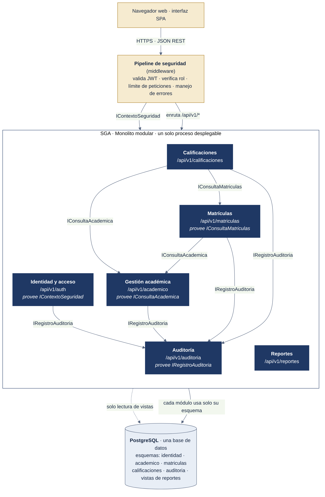

# Arquitectura de un Sistema de Gestión Académica (SGA)

Propuesta de arquitectura de software para un Sistema de Gestión Académica de una institución de educación superior. Se construyó a partir de 12 requerimientos funcionales y 12 no funcionales, con el apoyo crítico de Google AI Studio.

- **Asignatura:** Arquitectura de Software (INGS0763) · Ingeniería de Sistemas · CUN
- **Autor:** Juan Pablo Vargas Sánchez
- **Docente:** Alexander Calderón Martínez
- **Fecha:** noviembre de 2026

> Alcance: esta entrega es una **arquitectura y sus modelos**, no una implementación. Las capacidades descritas son propuestas de diseño; los métodos para verificarlas están en la matriz de trazabilidad.

## La arquitectura en una frase

Un **monolito modular en capas** (seis módulos con interfaces explícitas y un esquema de base de datos por módulo), expuesto como **API REST**, desplegado en **dos nodos sin estado** detrás de un balanceador, con **PostgreSQL administrado en alta disponibilidad** y respaldo externo continuo.



## Informe final

**[Informe en PDF](informe/Informe_SGA_Vargas_Juan_Pablo.pdf)** · **[versión en Word](informe/Informe_SGA_Vargas_Juan_Pablo.docx)**

## Contenido

| Sección | Archivo |
|---|---|
| Análisis del problema y de los requerimientos | [docs/01-analisis-requisitos.md](docs/01-analisis-requisitos.md) |
| 6.1 Casos de uso | [docs/modelos/01-casos-de-uso.md](docs/modelos/01-casos-de-uso.md) |
| 6.2 Componentes (vista lógica) | [docs/modelos/02-componentes.md](docs/modelos/02-componentes.md) |
| 6.3 Despliegue | [docs/modelos/03-despliegue.md](docs/modelos/03-despliegue.md) |
| 6.4 Datos conceptual | [docs/modelos/04-datos.md](docs/modelos/04-datos.md) |
| 6.5 Secuencia (matrícula) | [docs/modelos/05-secuencia.md](docs/modelos/05-secuencia.md) |
| 6.6 Matriz de trazabilidad | [docs/modelos/06-trazabilidad.md](docs/modelos/06-trazabilidad.md) |
| Riesgos y validación | [docs/07-riesgos.md](docs/07-riesgos.md) |
| Decisiones arquitectónicas (ADR) | [docs/adr/](docs/adr/) |
| Uso de Google AI Studio | [docs/ai-studio/](docs/ai-studio/) |

## Decisiones arquitectónicas

| ADR | Decisión |
|---|---|
| [ADR-001](docs/adr/ADR-001-estilo-monolito-modular.md) | Monolito modular en capas como estilo arquitectónico |
| [ADR-002](docs/adr/ADR-002-concurrencia-matricula.md) | Control de concurrencia de la matrícula con bloqueo pesimista |
| [ADR-003](docs/adr/ADR-003-despliegue-alta-disponibilidad.md) | Despliegue con réplicas, base de datos en alta disponibilidad y respaldo externo |
| [ADR-004](docs/adr/ADR-004-autenticacion-sin-estado.md) | Autenticación sin estado con token corto y token de renovación |
| [ADR-005](docs/adr/ADR-005-auditoria-transaccional.md) | Auditoría escrita en la misma transacción del cambio |

## Uso de Google AI Studio

Se usaron 7 prompts con Gemini 3.8 Flash en una sola conversación ([guía](docs/ai-studio/GUIA-PROMPTS.md)). **Conversación original en Google AI Studio:** [abrir](https://aistudio.google.com/app/prompts?state=%7B%22ids%22:%5B%221NcbJ3YkHGzE2xID9EykCrpI4RXmgqqe8%22%5D,%22action%22:%22open%22,%22userId%22:%22113748348275050694995%22,%22resourceKeys%22:%7B%7D%7D&usp=sharing). Las respuestas completas están en [docs/ai-studio/respuestas/](docs/ai-studio/respuestas/), y cada propuesta se evaluó en [evaluacion-ia.md](docs/ai-studio/evaluacion-ia.md).

**Resultado:** de 93 propuestas de la IA, el equipo aceptó 47, modificó 40 y descartó 6.

## Estructura del repositorio

```
docs/                 análisis, modelos, riesgos, ADR y evidencias de IA
modelos/fuentes/      código fuente de los diagramas (Mermaid y script del diagrama de casos de uso)
modelos/imagenes/     diagramas exportados (PNG y SVG)
```

Los diagramas en Mermaid se ven directamente en GitHub. Para regenerar las imágenes: `npx @mermaid-js/mermaid-cli -i modelos/fuentes/<archivo>.mmd -o modelos/imagenes/<archivo>.png` y `python3 modelos/fuentes/01-casos-de-uso.py`.
