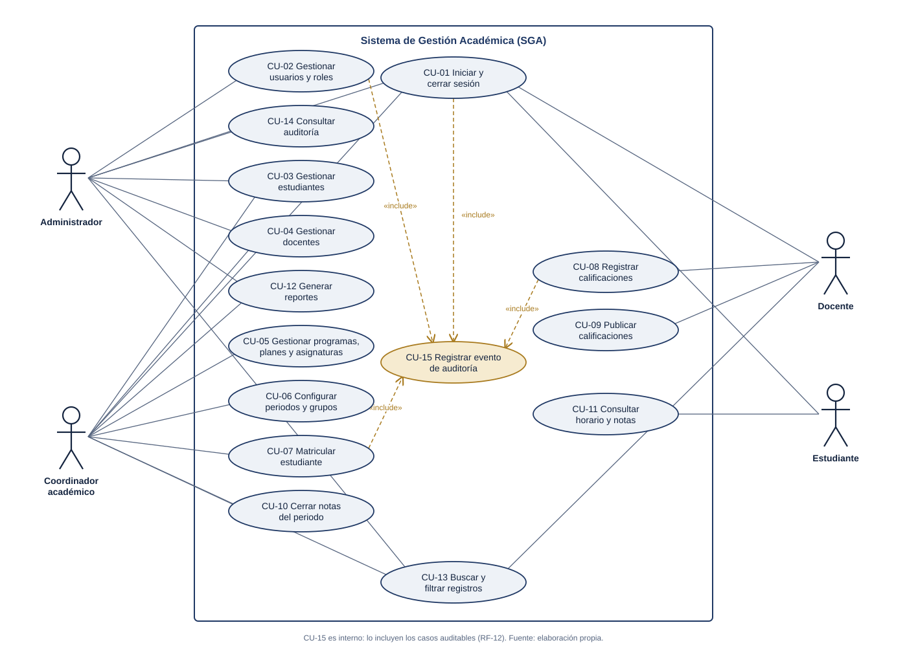

# 6.1 Modelo de casos de uso

## Figura 1. Diagrama de casos de uso del SGA

*Fuente: elaboración propia. El código fuente del diagrama está en `modelos/fuentes/01-casos-de-uso.py`.*

**Notación UML:** las figuras son los actores, las elipses los casos de uso y el rectángulo el límite del sistema. Una línea continua indica que el actor participa en el caso de uso. Una flecha punteada «include» indica que el caso de uso **siempre** ejecuta al caso incluido: CU-15 Registrar evento de auditoría es un caso interno, sin actor, que cumple RF-12.

## Descripción de los casos de uso principales

| Id | Caso de uso | Actor(es) | Descripción breve | Precondición | Resultado | RF |
|---|---|---|---|---|---|---|
| CU-01 | Iniciar y cerrar sesión | Todos | El usuario ingresa con su correo y contraseña; el sistema verifica el hash y entrega los tokens. Al cerrar sesión, revoca el token de renovación. | Cuenta activa | Sesión iniciada o cerrada; evento auditado | RF-01 |
| CU-02 | Gestionar usuarios y roles | Administrador | Crea cuentas, asigna o retira roles y desactiva usuarios. | Sesión de administrador | Roles actualizados; cambio auditado | RF-02 |
| CU-03 | Gestionar estudiantes | Administrador, coordinador | Registra, consulta, actualiza y desactiva estudiantes (baja lógica). | Programa existente | Estudiante activo o inactivo | RF-03 |
| CU-04 | Gestionar docentes | Administrador, coordinador | Igual que CU-03 para docentes. | — | Docente activo o inactivo | RF-04 |
| CU-05 | Gestionar programas, planes y asignaturas | Coordinador | Crea y actualiza programas, planes de estudio y asignaturas (código, nombre, créditos, semestre). | — | Oferta académica actualizada | RF-05 |
| CU-06 | Configurar periodos y grupos | Coordinador | Define el periodo y sus fechas; crea grupos con cupo, docente, horario y aula o enlace. | Asignatura y docente activos | Grupo listo para matrícula | RF-06 |
| CU-07 | **Matricular estudiante** | Coordinador | Inscribe a un estudiante en uno o varios grupos, validando cupo, duplicados, cruce de horario y fechas (ver Figura 5a). | Periodo abierto, estudiante activo | Matrícula creada o rechazo con motivo; evento auditado | RF-07 |
| CU-08 | **Registrar calificaciones** | Docente | Registra o corrige notas por evaluación en sus grupos, dentro de las fechas y antes del cierre. | Docente asignado al grupo | Notas en borrador; cambios auditados | RF-08 |
| CU-09 | Publicar calificaciones | Docente | Hace visibles las notas para los estudiantes. | Notas registradas | Notas publicadas | RF-08, RF-09 |
| CU-10 | Cerrar notas del periodo | Coordinador | Bloquea la edición de notas del periodo (RN-12). | Fecha límite cumplida | Notas congeladas | RF-08 |
| CU-11 | Consultar horario y notas | Estudiante | Consulta sus asignaturas, su horario y sus notas publicadas. Solo ve sus propios datos. | Estudiante matriculado | Información propia mostrada | RF-09 |
| CU-12 | Generar reportes | Coordinador, administrador | Reportes de matriculados, grupos, asignaturas y resultados con filtros por periodo y programa. | — | Reporte en pantalla o CSV | RF-10 |
| CU-13 | Buscar y filtrar registros | Administrador, coordinador, docente | Busca por identificador o nombre y filtra por programa, periodo o estado, según su rol. | — | Lista filtrada | RF-11 |
| CU-14 | Consultar auditoría | Administrador | Consulta los eventos por usuario, acción y rango de fechas. | — | Lista de eventos | RF-12 |
| CU-15 | Registrar evento de auditoría | (interno) | Guarda usuario, fecha, acción y registro afectado dentro de la misma transacción del cambio. | Incluido por CU-01, 02, 07 y 08 | Evento inmutable | RF-12 |
