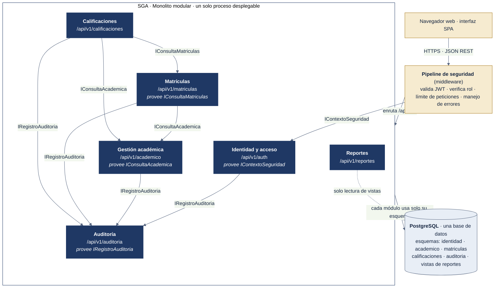
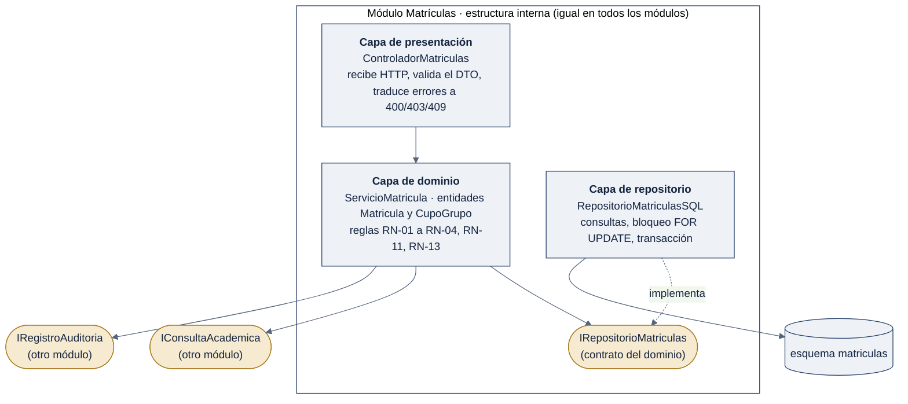

# 6.2 Modelo de componentes (vista lógica)

## Figura 2a. Módulos, interfaces y dependencias

*Fuente: elaboración propia a partir de ADR-001 y de la evaluación de la respuesta P3 de Google AI Studio.*

**Cómo leerlo:** cada caja azul es un módulo del monolito con su ruta REST. Una flecha indica que un módulo **usa** a otro, y la etiqueta es la **interfaz** que consume. Ningún módulo accede a las tablas de otro: solo a su propio esquema (ADR-001). Reportes es la única excepción controlada: lee vistas con un usuario de base de datos de solo lectura.

## Responsabilidades e interfaces

| Módulo | Responsabilidad | Endpoints REST principales | Provee | Depende de | RF / RNF |
|---|---|---|---|---|---|
| **Identidad y acceso** | Credenciales (hash Argon2id), inicio y cierre de sesión, emisión de tokens, usuarios, roles y permisos. | `POST /auth/iniciar-sesion` · `POST /auth/cerrar-sesion` · `POST /auth/renovar` · `PUT /auth/usuarios/{id}/rol` | `IContextoSeguridad` (usuario actual, rol) | `IRegistroAuditoria` | RF-01, RF-02, RNF-01, RNF-11 |
| **Gestión académica** | Estudiantes, docentes, programas, planes, asignaturas, periodos, grupos, horarios y aulas o enlaces. Baja lógica. Cierre de notas del periodo. | `GET/POST/PUT /academico/estudiantes` · `…/docentes` · `…/programas` · `…/asignaturas` · `…/periodos` · `…/grupos` · `POST /academico/periodos/{id}/cerrar-notas` | `IConsultaAcademica` (¿estudiante activo?, datos del grupo, docente asignado, horario, estado del periodo) | `IRegistroAuditoria` | RF-03 a RF-06, RF-11 |
| **Matrículas** | Matricular y anular con control de cupo, duplicados y cruce de horario en una transacción. Dueño de `cupo_grupo`. | `POST /matriculas` · `DELETE /matriculas/{id}` · `GET /matriculas?estudiante=&periodo=` · `GET /matriculas/mi-horario` | `IConsultaMatriculas` (matriculados de un grupo, matrículas de un estudiante) | `IConsultaAcademica`, `IRegistroAuditoria` | RF-07, RF-09, RNF-07 |
| **Calificaciones** | Registrar, actualizar y publicar notas. Solo el docente del grupo, dentro de fechas y antes del cierre. | `GET /calificaciones/grupos/{id}` · `PUT /calificaciones/grupos/{id}` · `POST /calificaciones/grupos/{id}/publicar` · `GET /calificaciones/mis-notas` | — | `IConsultaAcademica`, `IConsultaMatriculas`, `IRegistroAuditoria` | RF-08, RF-09, RNF-07, RNF-11 |
| **Reportes** | Reportes de matriculados, grupos, asignaturas y resultados con filtros por periodo y programa. Solo lectura. | `GET /reportes/matriculados?periodo=&programa=` · `GET /reportes/resultados?periodo=&programa=` · `GET /reportes/grupos?periodo=` | — | Vistas de solo lectura | RF-10, RF-11, RNF-02 |
| **Auditoría** | Registrar eventos auditables de solo inserción y consultarlos (solo el administrador). | `GET /auditoria/eventos?usuario=&accion=&desde=&hasta=` | `IRegistroAuditoria` | — | RF-12, RNF-10 |

**Búsqueda y filtros (RF-11):** cada listado acepta `?q=` (identificador o nombre) y los filtros `programa`, `periodo` y `estado` que correspondan al módulo. El dominio aplica siempre el alcance del rol: un docente solo ve sus grupos y un estudiante solo sus datos (RNF-11).

**Documentación de la API (RNF-08):** todos los endpoints se describen en una especificación OpenAPI 3 (`api/openapi.yaml`).

## Figura 2b. Estructura interna de un módulo

*Fuente: elaboración propia.*

Todos los módulos siguen las mismas tres capas:

- **Presentación:** controlador REST. Recibe la petición, valida el formato del DTO y traduce errores del dominio a códigos HTTP (400 datos inválidos, 403 sin permiso, 409 conflicto, como "sin cupo").
- **Dominio:** servicios y entidades con las reglas de negocio. Depende solo de contratos (interfaces), nunca de la base de datos (principio de inversión de dependencias).
- **Repositorio:** implementa el contrato con SQL, maneja la transacción y el bloqueo.

Gracias a esta separación, cambiar el motor de base de datos o la interfaz no obliga a reescribir las reglas de negocio (RNF-05).
