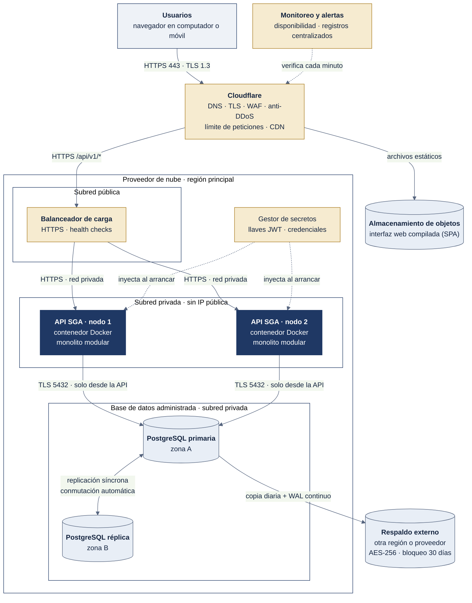

# 6.3 Modelo de despliegue

## Figura 3. Nodos, canales y controles de seguridad

*Fuente: elaboración propia, a partir de la propuesta P6 de Google AI Studio con las correcciones de la evaluación (ADR-003).*

## Nodos

| Nodo | Qué ejecuta | Por qué |
|---|---|---|
| Cloudflare | DNS, TLS, WAF, anti-DDoS, límite de peticiones y CDN | Primera línea de defensa y distribución de la interfaz sin costo adicional (RNF-01, RNF-02). |
| Almacenamiento de objetos | Interfaz web compilada (HTML, CSS, JS) | Archivos estáticos sin consumir CPU de la API (RNF-12). |
| Balanceador de carga administrado | Reparte el tráfico HTTPS entre los nodos y verifica su salud | Si un nodo falla, el tráfico pasa al otro en segundos. Al ser administrado, el proveedor lo mantiene redundante, así que no es un punto único de falla (RNF-03; crítica de la IA en P7). |
| API SGA · nodos 1 y 2 | El monolito modular en contenedores Docker, sin estado | Redundancia y escalado horizontal: agregar un tercer nodo no requiere cambios (RNF-04, ADR-004). |
| PostgreSQL primaria y réplica | Base de datos administrada en dos zonas | Elimina el punto único de falla de la base de datos, con conmutación automática (RNF-03, RNF-07). |
| Respaldo externo | Copia diaria y WAL continuo, cifrados y con bloqueo de 30 días | RPO de 15 min y RTO de 2 h; protección contra *ransomware* (RNF-09). |
| Gestor de secretos | Llaves JWT y credenciales | Nada sensible en el repositorio (RNF-01). |
| Monitoreo y alertas | Verificación de disponibilidad y registros centralizados | Medir el 99,5 % y reaccionar a tiempo (RNF-03, RNF-10). |

## Controles de seguridad por canal

| Canal | Protocolo | Control |
|---|---|---|
| Usuario → Cloudflare | HTTPS 443, TLS 1.3 | Redirección forzada de HTTP a HTTPS; WAF y límite de peticiones. |
| Cloudflare → Balanceador | HTTPS | Solo se aceptan conexiones desde Cloudflare. |
| Balanceador → API | HTTPS en red privada | Los nodos no tienen IP pública. |
| API → PostgreSQL | TLS, puerto 5432 | Subred privada; el puerto solo acepta tráfico de los nodos de la API; usuario de base de datos con permisos mínimos por esquema. |
| PostgreSQL → Respaldo | Cifrado AES-256 | Almacenamiento en otra región o proveedor, con bloqueo de objetos. |
