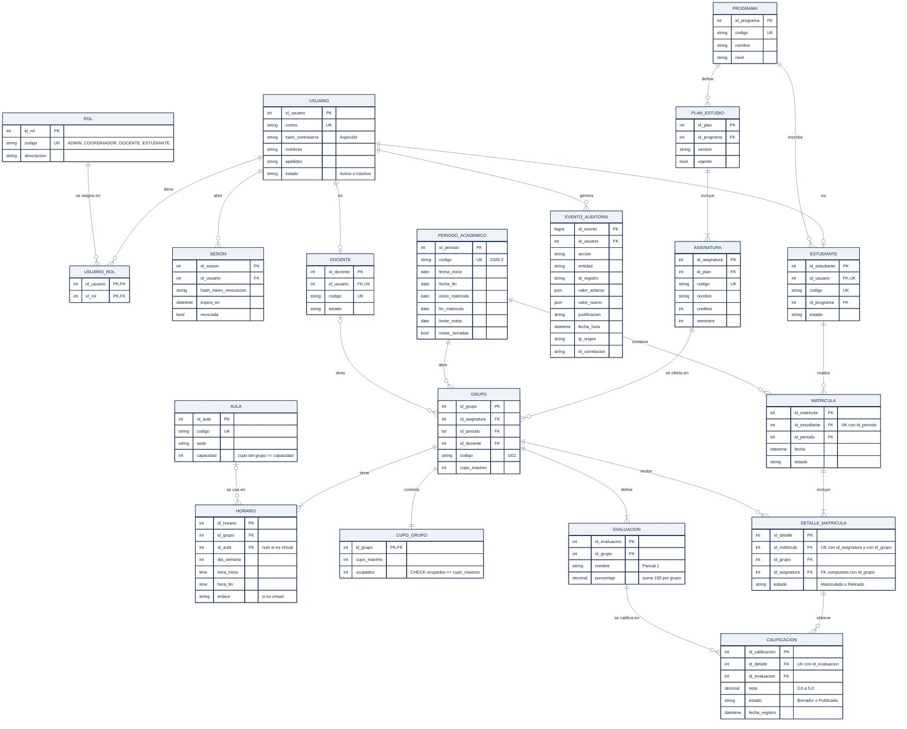

# 6.4 Modelo de datos conceptual

## Figura 4. Entidades, atributos principales y cardinalidades

*Fuente: elaboración propia, a partir de la propuesta P4 de Google AI Studio con las correcciones de la evaluación.*

**Notación (pata de gallo):** `||` uno y solo uno · `o|` cero o uno · `|{` uno o muchos · `o{` cero o muchos.

## Entidades por módulo

Cada entidad pertenece al esquema del módulo que es su dueño (ADR-001).

| Módulo (esquema) | Entidades |
|---|---|
| Identidad y acceso | Usuario, Rol, UsuarioRol, Sesion |
| Gestión académica | Estudiante, Docente, Programa, PlanEstudio, Asignatura, PeriodoAcademico, Grupo, Horario, Aula |
| Matrículas | Matricula, DetalleMatricula, CupoGrupo |
| Calificaciones | Evaluacion, Calificacion |
| Auditoría | EventoAuditoria |

## Cardinalidades más importantes

| Relación | Cardinalidad | Significado |
|---|---|---|
| Usuario – Rol | M:N (vía UsuarioRol) | Un usuario puede tener varios roles; por ejemplo, un docente que también coordina (S-05). |
| Usuario – Estudiante / Docente | 1 : 0..1 | Un usuario puede ser estudiante, docente, ambos o ninguno (administrador). |
| Programa – PlanEstudio – Asignatura | 1:N y 1:N | Un programa tiene varios planes (versiones) y cada plan agrupa asignaturas con su semestre (RF-05). |
| Asignatura – Grupo | 1:N | Una asignatura se ofrece en varios grupos por periodo. |
| PeriodoAcademico – Grupo | 1:N | Cada grupo pertenece a un solo periodo. |
| Docente – Grupo | 0..1 : N | Un grupo puede crearse sin docente y asignarse después (RF-06). |
| Grupo – Horario | 1 : 1..N | Un grupo tiene una o más franjas semanales. |
| Aula – Horario | 0..1 : N | Una franja presencial usa un aula; una virtual usa un enlace. El cupo del grupo no puede superar la capacidad del aula (RN-15, aporte de la IA en P7). |
| Grupo – CupoGrupo | 1:1 | Control de ocupación, propiedad del módulo Matrículas (ADR-002). |
| Estudiante – Matricula | 1:N | Una matrícula por estudiante y periodo (restricción única). |
| Matricula – DetalleMatricula | 1 : 1..N | Una matrícula incluye uno o más grupos. |
| Grupo – Evaluacion | 1 : 1..N | Los cortes del grupo, cuyos porcentajes suman 100. |
| DetalleMatricula – Calificacion – Evaluacion | 1:N y N:1 | Una nota por estudiante matriculado y por evaluación (restricción única). |

## Restricciones de integridad (RNF-07)

| Restricción | Protege la regla |
|---|---|
| `UNIQUE (id_estudiante, id_periodo)` en Matricula | Una sola matrícula por estudiante y periodo. |
| `UNIQUE (id_matricula, id_grupo)` en DetalleMatricula | No matricular dos veces el mismo grupo (RN-01). |
| `UNIQUE (id_matricula, id_asignatura)` en DetalleMatricula | No matricular dos grupos de la misma asignatura (RN-01). |
| FK compuesta `(id_grupo, id_asignatura)` → Grupo | El `id_asignatura` del detalle coincide con el del grupo. |
| `CHECK (ocupados <= cupo_maximo)` en CupoGrupo | Nunca hay sobrecupo, aunque falle la aplicación (RN-02). |
| `UNIQUE (id_detalle, id_evaluacion)` en Calificacion | Una sola nota por estudiante y evaluación. |
| `CHECK (nota BETWEEN 0 AND 5)` en Calificacion | Escala de notas (RN-06). |
| Solo INSERT y SELECT sobre EventoAuditoria | Auditoría inmutable (RN-14, ADR-005). |
| Baja lógica (`estado`) en Usuario, Estudiante y Docente | Se conserva el historial (S-03). |
