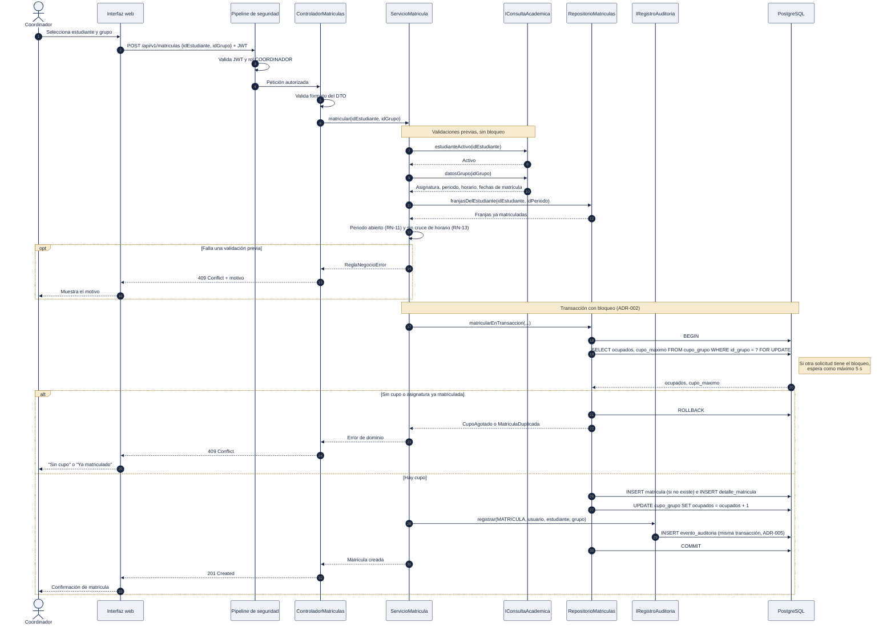
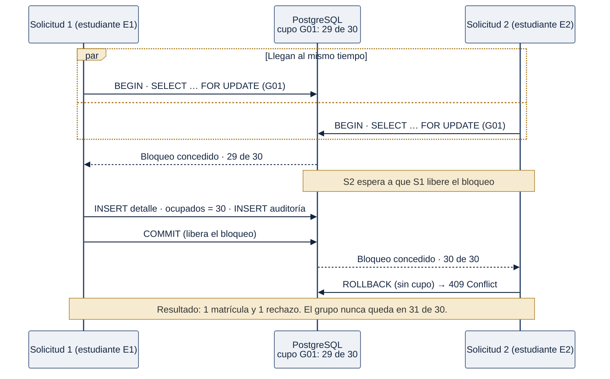

# 6.5 Vista de secuencia: matrícula de un estudiante

Se modela la matrícula porque es el proceso más crítico del sistema: combina reglas de negocio, concurrencia y auditoría (RF-07, RF-12, RNF-07).

## Figura 5a. Flujo completo de la matrícula

*Fuente: elaboración propia, a partir de la propuesta P5 de Google AI Studio con las correcciones de la evaluación.*

**Puntos clave del flujo:**

1. **Pasos 2 a 5.** El pipeline de seguridad valida el token y el rol antes de que la petición llegue al módulo (RF-02, RNF-01).
2. **Pasos 7 a 13.** Las validaciones que no dependen del cupo se hacen **antes** del bloqueo: estudiante activo, periodo abierto y cruce de horario. Así el bloqueo dura lo mínimo.
3. **Paso 19.** `SELECT … FOR UPDATE` bloquea solo la fila del grupo en `cupo_grupo`. Otras matrículas de otros grupos siguen en paralelo (ADR-002).
4. **Pasos 26 a 30.** La matrícula, el cupo y el registro de auditoría se confirman en **una sola transacción**: o se guardan los tres o ninguno (ADR-005).
5. **Respuestas:** `201 Created` si se matricula; `409 Conflict` si no hay cupo, si hay un duplicado o si falla una regla de negocio.

## Figura 5b. Dos solicitudes simultáneas por el último cupo

*Fuente: elaboración propia.*

Este escenario es la prueba de aceptación de RNF-07. Se repite con 50 solicitudes simultáneas sobre un grupo de 1 cupo, y el resultado esperado es exactamente 1 matrícula.

Cuando una matrícula incluye varios grupos, los bloqueos se toman en **orden ascendente de `id_grupo`** para evitar interbloqueos entre dos solicitudes que comparten grupos (aporte de la IA, P5).
